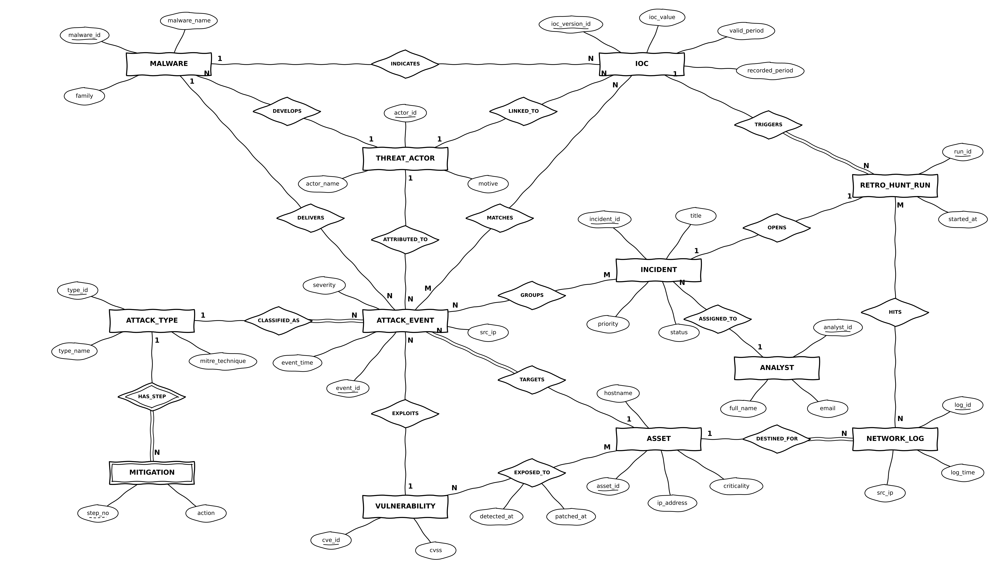

# SentinelX: Cyber Attack Intelligence and Threat Hunting Platform

A small Security Operations Centre (SOC) database built for the **Database Systems (BCSE302P) lab project** at VIT Vellore.
Firewall logs, detected attacks, the servers they hit, attacker groups, malware, CVEs, indicators of compromise (IOCs),
incidents and analysts are stored once, linked properly, and searched with plain SQL.

- **16 tables in Third Normal Form (3NF)** plus an append-only audit trail, MySQL 8.0
- **Everything here was actually run** on MySQL 8.0.46. The raw client output is in [`mysql-output/`](mysql-output)
- **49 automatic tests**, run as root, analyst, viewer and admin; all pass on a clean build
- The project is the database: there is no application layer. See [`reports/Review3_scope_revision.md`](reports/Review3_scope_revision.md) for what was removed since Review 2 and why.
- Two features of our own:
  - **Retro-hunt:** when a new bad IP is added, a trigger searches old logs for the time it was already hostile but not yet known, and opens an incident if it finds anything.
  - **Time machine:** every indicator stores *when it was hostile* and *when we learned about it*, so results can be split into "known then" and "learned later".

## ER diagram



Chen notation: 12 entities, 17 relationships (12 one-to-many, one of them identifying; 4 many-to-many; 1 one-to-one).
The relational schema with every foreign key is in [`diagrams/relational_schema.png`](diagrams/relational_schema.png).

## What's in the repo

| Folder | Contents |
| --- | --- |
| [`reports/`](reports) | Review 1 and Review 2 reports as PDF and Word, and the Review 3 scope revision |
| [`sql/`](sql) | The SQL, in run order: `01_ddl.sql` to `13_tests.sql`, plus `sentinelx_schema.sql` (schema only) |
| [`runner/`](runner) | One-click Windows runner that executes every step and saves the output |
| [`mysql-output/`](mysql-output) | Real output of every step from MySQL 8.0.46 (`.err.txt` files hold the intended error demos) |
| [`demo/`](demo) | Review 3 live-demo run sheet, one rerunnable file per demo step, concurrency and backup/recovery scripts, rehearsal evidence |
| [`docs/`](docs) | Viva map: every question in the bank answered on our own tables |
| [`diagrams/`](diagrams) | ER diagram, relational schema, system architecture |
| [`tools/`](tools) | Python that generates the seed data, the step files and the architecture figure, and renders output into screenshots. `gen_steps.py` holds the SQL; edit it there, not in `sql/` |

## What the SQL covers

| Area | What's there |
| --- | --- |
| DDL | 16 tables plus `incident_audit`, with PRIMARY KEY, FOREIGN KEY (CASCADE / SET NULL), UNIQUE, CHECK, ENUM, indexes |
| DML | 10 assets, 30 attacks, 12 IOCs, 7 incidents, 50,021 log lines (50,000 generated with a recursive CTE), UPDATE, DELETE, and 5 statements rejected by constraints |
| Queries | 40 queries: basic, aggregate (WHERE vs HAVING), all join types (FULL OUTER emulated), subqueries (incl. the NOT IN + NULL pitfall), UNION / INTERSECT / EXCEPT, CASE / COALESCE / NULLIF / date / string / numeric, window functions |
| Complex queries | 11 multi-table business queries (CQ-01 to CQ-11) |
| Views | `v_attack_details` (5-table join), `v_asset_risk` (aggregated), `v_my_incidents` (row-level security, WITH CHECK OPTION), `v_vulnerability`, `v_retro_hunt_summary`, `v_ioc` |
| Routines | `fn_severity_label`, `fn_asset_risk`; `sp_assign_incident` (SELECT ... FOR UPDATE, SIGNAL, ROLLBACK, checks its caller), `sp_attack_report`, `sp_report_ioc`, `sp_load_log_batch`, `sp_whoami` |
| Triggers | `trg_attack_auto_incident`, `trg_ioc_retro_hunt`, `trg_ioc_no_overlap`, `trg_ioc_no_delete`, `trg_incident_audit_update/delete`, `trg_audit_no_update/delete` |
| Cursors | `sp_escalate_incidents`, `sp_asset_risk_report` |
| Transactions | SAVEPOINT / ROLLBACK TO / COMMIT; a failed statement does not roll back a transaction, an exit handler does; lost update, FOR UPDATE, deadlock and isolation levels in two terminals |
| Indexes | EXPLAIN before and after `idx_src_time`: full scan of 50,163 rows down to a range read of 8; leftmost prefix and skip scan; an index hidden by a function; EXPLAIN ANALYZE |
| Security | Roles `sx_admin`, `sx_analyst`, `sx_viewer`; analysts and viewers reach data only through views and procedures; GRANT / REVOKE; lockout after 3 wrong passwords; append-only audit trail; SQL injection, unsafe vs parameterised; backup and point-in-time recovery |

## Run it yourself

**Windows (easiest):** install MySQL Server 8.0.31 or later, then double-click `runner/RUN_ME.bat` and type your MySQL root
password. It runs every file in `runner/steps/` and writes the output to `runner/out/`.

**Any OS, with the mysql client:**

```bash
mysql -u root -p < sql/01_ddl.sql
mysql -u root -p sentinelx < sql/02_dml.sql
mysql -u root -p sentinelx --table < sql/03_queries_A_to_G.sql
# ... and so on up to 11_indexes_explain.sql
```

`12_security.sql` and `13_tests.sql` switch between users, so run them through the runner.

> **Warning:** `01_ddl.sql` starts with `DROP DATABASE IF EXISTS sentinelx`.
>
> Parts of `12_security.sql` and `13_tests.sql` have to be run while logged in as the test users they create (`divya.iyer`, `rahul.mehta`, `ananya.rao`); the runner does this for you. These are local test accounts with made-up passwords. Three wrong passwords lock an account for a day: `demo/00_reset_accounts.sql` unlocks them.

## About the data

The data is a hand-made test set, so every result can be checked by hand. Attacker IPs come from the address ranges reserved
for documentation (192.0.2.0/24, 198.51.100.0/24, 203.0.113.0/24), so no real address is marked as bad. Attacker and
malware names are made up. The CVE IDs are real.

## Team

| Name | Registration No. |
| --- | --- |
| Shlok Gupta | 24BCI0061 |
| Shreya Bhushan | 24BCI0086 |
| Yashneil Purkayastha | 24BDS0158 |

Faculty: Dr. Anand Bihari, School of Computer Science and Engineering, VIT Vellore.
